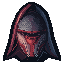
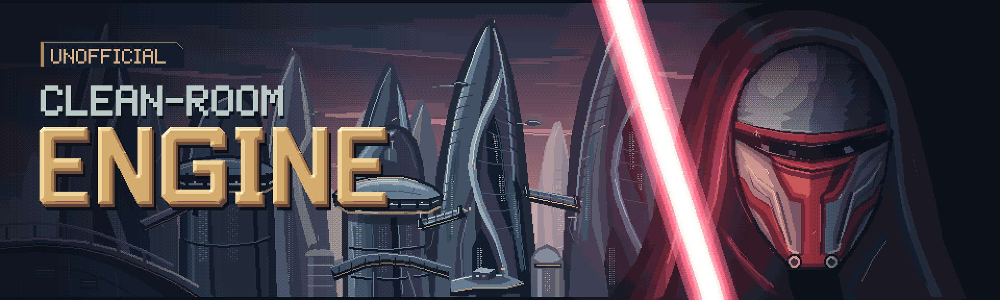

<p align="center">
  
</p>

<h1 align="center">Clean-room Interoperability Engine</h1>

<p align="center"><b>An unofficial, clean-room engine that runs your own copy of Knights of the Old Republic.</b><br>
Reads a legally acquired install in place, no game assets shipped, no original executable required.</p>

<p align="center"><sub>Unofficial and non-commercial. Not affiliated with or endorsed by BioWare, Electronic Arts,<br>
Lucasfilm, or Disney. The names and the game belong to their owners.</sub></p>

<p align="center">
  
</p>

<p align="center">
  
  
  
  
  
</p>

## What it is

This is not a graphics mod or a wrapper around the original game: the engine replaces
the original executable with independently written code while leaving the game data
untouched. It implements the game's file formats, scripting, dialogue and gameplay
systems so the original content runs on a new runtime.

The goal is faithful KotOR gameplay, with an optional modern presentation path.

## Status

Sprint 14 (P6 correctness) is complete — gate S14 met. The K1 playability closeout on
top of it adds character generation, a third-person player avatar, animated companions,
in-scene dialogue faces, spendable level-up points, and interactive Pazaak, swoop and
turret panels. See [`docs/K1_PLAYABILITY.md`](docs/K1_PLAYABILITY.md) for what's
playable and the remaining bounded gaps.

What that looks like in numbers:

- **117 / 117** modules load
- **8,666 / 8,666** scripts run (303,616 ACTION calls, 0 VM faults)
- **772 / 772** script actions mapped
- **86 / 86** GUI screens render interactively · **61** Bink movies play
- **55 / 55** CTest targets pass · original saves load and round-trip

Roadmap: Sprint 15 release candidate → 16 remaster stage 1 → 17 remaster stages 2–4 +
modding → 18 KotOR 2 gameplay parity (the K2 profile already loads three areas).

## Getting started

You need a legally acquired **KotOR 1.0.3.0** install (Steam or GOG). Build the engine,
then point it at the install:

```bat
cd engine
scripts\configure.bat msvc-release
scripts\build.bat msvc-release

build\msvc-release\kotor_engine.exe --install "D:\path\to\swkotor" --new-game
```

`--install` defaults to `KOTOR_INSTALL` or the Steam path if it finds one. Useful flags:
`--vulkan` / `--gl`, `--module <stem>`, `--third-person`, `--chargen`, `--playthrough`.
Full build, test and flag reference: [`engine/docs/BUILD.md`](engine/docs/BUILD.md).

## What it does

- **Reads the real game data.** BIF/RIM/ERF archives, KEY index, TLK strings, GFF, 2DA,
  NCS scripts, MDL/MDX models, walkmeshes — resolved through a five-pass VFS with
  Override/mod precedence and TSLPatcher-style 2DA merges.
- **Runs the game.** A native NCS VM executes every shipped script; the d20 systems
  layer covers combat, Force powers, feats, skills, alignment, factions, merchants,
  encounters, companions and journal.
- **Presents it.** SDL3 platform with a Vulkan 1.4 primary renderer and an OpenGL 4.5
  reference backend; all 86 GUI screens, 61 Bink movies, viseme-driven facial rig and
  a 48 kHz four-bus audio mixer.
- **A Classic path and a Remaster path.** 1:1 original behavior (including seven
  documented classic-vs-fixed bug-parity quirks) or an optional modern presentation.
- **Loads your saves.** Original `SAVEGAME.sav` slots read and write byte-identically;
  KotOR 2 areas load behind a profile gate.
- **Clean-room verified.** 10,849 functions decompiled, the full script corpus decoded,
  and a semantic differential run against recorded retail traces.

## Documentation

- [`docs/MASTER_PLAN.md`](docs/MASTER_PLAN.md) — program lanes, phases, gates, verification
- [`docs/K1_PLAYABILITY.md`](docs/K1_PLAYABILITY.md) — current playable surface and remaining gaps
- [`docs/EVIDENCE.md`](docs/EVIDENCE.md) — the full verified-progress log and sprint reports
- [`engine/docs/BUILD.md`](engine/docs/BUILD.md) — build, run and test
- [`tools/README.md`](tools/README.md) — the reverse-engineering tooling
- [`docs/adr/`](docs/adr/) — architecture decisions (runtime, coordinates, distribution)

## Repository layout

```
engine/      C++23 runtime: SDL3, Vulkan 1.4 / OpenGL 4.5, ImGui
docs/        master plan, evidence, recon notes, sprint plans/reports, ADRs
tools/       read-only inventory/parsers, Ghidra exporters, action-table and evidence tooling
artifacts/   local only (gitignored): Ghidra projects, exports, caches, captured evidence
```

## Legal and scope

This is an unofficial, non-commercial interoperability and research project. It is not
affiliated with or endorsed by BioWare, Electronic Arts, Lucasfilm, Disney, or any
platform holder. No game assets, extracted data, save files, or decompiled program text
are committed here. The header illustrations are original pixel art drawn for this
project with Agent Art, not extracted game assets or official branding. The depicted
characters and setting belong to their respective owners.

You must supply your own legally acquired game installation. The project does not
implement DRM, license checks, or ownership verification. External GPL/LGPL tools are
used as independent oracles or authoring tools only; their code is not linked into the
engine. A project license has not been selected yet; no license is granted until one is
added. Nothing in this repository is legal advice.

## Contributing

Evidence first: claims about the binary or formats must cite a build hash, an
address/offset, and tool/test evidence. Keep game-derived artifacts out of commits, and
keep implementation code independent of GPL prior-art source.
